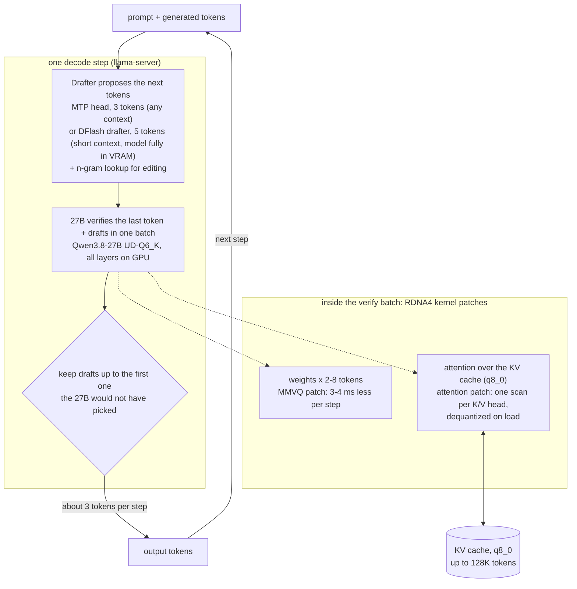
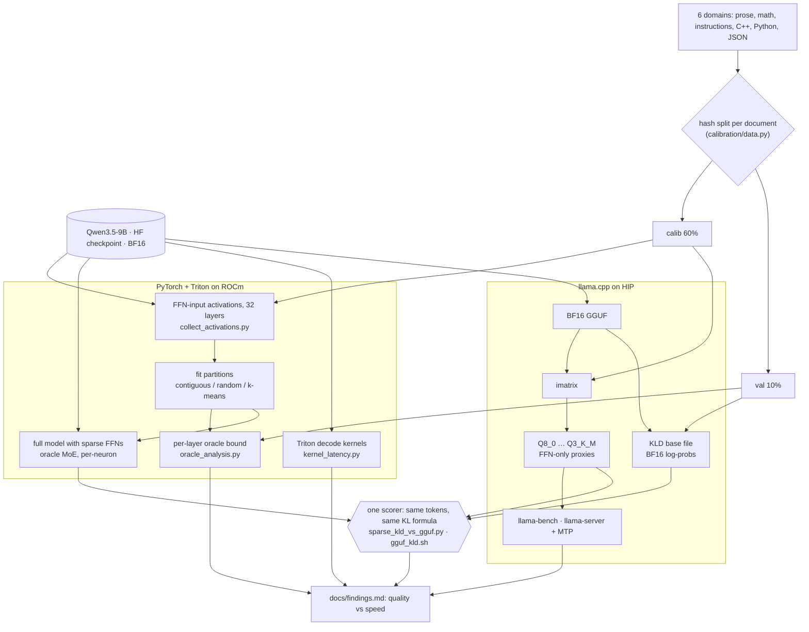

# Dense to MoE: can a pretrained LLM be made sparse for faster local inference?

Experiments on converting the dense **Qwen3.5-9B** LLM into a sparse **Mixture-of-Experts (MoE)**
by partitioning its feed-forward (FFN) neurons, with custom **Triton** kernels on **AMD RDNA4 GPUs
(ROCm)**. The sparse variants are benchmarked against the practical alternatives for local
inference: **llama.cpp GGUF quantization** (Q8_0 to Q3_K_M) and **MTP speculative decoding**.
Quality is measured as **KL divergence** against the BF16 model, using the same protocol as
`llama-perplexity`.

The sparse route failed, so the later work makes the practical route faster: speculative decoding
for **Qwen3.5-9B** and **Qwen3.8-27B**, and llama.cpp kernel patches for RDNA4.

Negative results are reported as negative results.

## Bottom line

The original project is finished. Closing summary: [docs/conclusions.md](docs/conclusions.md).
Follow-up tests are listed in [docs/roadmap.md](docs/roadmap.md).
- **Sparsifying a dense model without training doesn't pay off.** This covers MoE conversion,
  activation sparsity, and keeping "hot" neurons in VRAM.
- **What does pay off, all lossless except the quant itself:**
  - Quantize until the model fits in VRAM.
  - Turn on speculative decoding: the model's MTP head, or a trained DFlash drafter when the model
    is fully in VRAM.
  - Add n-gram drafting for editing.
  - On RDNA4, patch two llama.cpp kernels (below). They matter most with speculative decoding
    and at long context.
- **Measured speeds:**
  - 9B: 132-163 tok/s on a 12-16 GB card.
  - 27B: 71 tok/s on 16 GB, 62.6 tok/s at near-lossless quality on 32 GB.
  - 27B at 120K tokens of context, near-lossless quant, MTP: 44.8 tok/s with both patches, 29.1
    on stock llama.cpp.
- **RDNA4 kernel fixes for llama.cpp** (neither is upstream):
  - **Weights (MMVQ):** a 7-line change makes speculative verification 14-23% faster on K-quants
    ([patch](patches/llama.cpp-rdna4-mmvq-multicol.patch), [evidence](docs/upstream_mmvq.md)).
  - **Attention at depth:** at 120K tokens the 27B loses its speed to attention over the KV cache,
    not to draft acceptance. The patch reads a q8_0 / q4_0 KV cache directly and scans each K/V
    head once per verify batch, so a 4-token batch costs what one token does. A q8_0 KV cache is
    then faster than f16 as well as 3.3 GiB smaller
    ([patch](patches/llama.cpp-rdna4-fattn-q8-tile.patch), [docs/depth.md](docs/depth.md)).
  - Without the patches, an f16 KV cache is the faster choice at long context (+22-31% at 120K).
- **Cheaper drafting (lossless, llama.cpp patch, not upstream):** each drafted token read the
  whole 1.29 GiB output layer. Letting the drafter score a 65,536-token shortlist halves the cost
  of a drafted token and makes longer drafts pay: 27B six-prompt mean 52.4 -> 58.7 tok/s at
  draft 4, 60.7 at draft 8 with a confidence cutoff; output identical
  ([patch](patches/llama.cpp-mtp-draft-shortlist.patch), [docs/shortlist.md](docs/shortlist.md)).
- **Lenient draft acceptance (lossy, opt-in, not recommended for daily use):** keeping drafted
  tokens the target rates at 30% or more of its top choice gives +10% at temperature 0 and +17%
  at temperature 1.0. The code-quality suite shows no loss within noise; nothing else was
  checked ([docs/lenient.md](docs/lenient.md)).

## Best setup so far

Qwen3.8-27B at UD-Q6_K, fully in VRAM, with speculative decoding and the two kernel patches.
Everything in the loop is lossless against the quantized model: a drafted token is kept only if
it is the token the 27B picks.



| 27B UD-Q6_K, MTP, q8_0 KV | 2K context | 32K | 64K | 120K |
|---|---:|---:|---:|---:|
| stock llama.cpp b12164, tok/s | 55.5 | 43.7 | 37.3 | 29.1 |
| both patches, tok/s | 58.3 | 53.6 | 47.5 | 44.8 |

- One R9700 (32 GB), 26.3 GiB at 131K context. Splitting the model over both cards gives the
  same speeds within 2% ([docs/depth.md](docs/depth.md) sections 8 and 10).
- At short context the DFlash drafter is faster than MTP (62.6 against 51.2 tok/s, measured on
  the older b11434 with the MMVQ patch, [docs/fast27b.md](docs/fast27b.md)). It was not
  re-measured on b12164 or with the attention patch.
- On a 16 GB card the same loop runs at IQ4_XS with MTP (71 tok/s); what to run per GPU size is
  in [docs/conclusions.md](docs/conclusions.md).

## Key results

**Training-free dense-to-MoE conversion doesn't pay off on this model.** The sparse kernels are
fast: a top-2-of-8 expert FFN runs 3.3x faster than the best dense kernel per layer at batch 1.
But even with a perfect (oracle) router, the quality loss is larger than 3-bit quantization.
Quantization plus MTP gives more speed at a fraction of the quality loss.

Mean KL divergence against llama.cpp BF16 (held-out text, 25,500 scored tokens), and decode speed on an
RX 9070 XT (llama-bench tg128, MTP via `llama-server --spec-type draft-mtp`):

| Variant | Mean KLD | Decode tok/s | With MTP |
|---|---:|---:|---:|
| PyTorch BF16 (implementation noise floor) | 0.0004 | | |
| Q8_0 | 0.0016 | 57.5 | 115.8 |
| Q6_K | 0.0028 | 70.3 | 117.4 |
| Q4_K_M | 0.0228 | 84.0 | 141.9 |
| **IQ4_XS** | **0.0184** | **89.6** | **148.0** |
| Q3_K_M | 0.0581 | 88.9 | |
| MoE 8 experts, top-6, oracle routing | 0.117 | | |
| MoE 8 experts, top-4, oracle routing | 0.376 | | |
| Per-neuron oracle, 50% of FFN neurons kept | 0.0103 | | |

- Expert partitions fitted on activations (balanced k-means on co-activation and contribution
  features) beat contiguous and random ones by about 20%, but nowhere near enough.
- Per-neuron selection is far better than fixed experts. Important neurons are token-specific
  and don't form stable groups, but the per-neuron oracle needs the full FFN computed first.
- Removing FFN bytes entirely from IQ4_XS would cap out at about 1.2x speedup (measured with
  FFN-only re-quantization proxies), below what MTP already gives.

Full numbers and methods: [docs/findings.md](docs/findings.md). Every command that was run, in
order, with descriptions: [docs/writeup.md](docs/writeup.md).

**Phase 3, predictive fine-grained neuron sparsity (Deja Vu / TEAL / CATS / WINA-style), doesn't
pay off either.**
- Quality only survives at single-neuron granularity: 8-neuron blocks already cost 6x
  IQ4_XS's KLD, even with a perfect choice.
- Training-free input sparsity (TEAL) at 75-90% of channels is nearly free in quality (KLD
  0.0093-0.0011), but the gain is small:
  - At most +4-12% single-token decode, even with an ideal kernel.
  - About 0% with MTP: the verify step checks ~4 tokens, and their combined masks cover the
    whole FFN.

Report: [docs/phase3_findings.md](docs/phase3_findings.md). Pre-registered gates and literature
review: [docs/phase3_research.md](docs/phase3_research.md).

**MTP tuning on the R9700:** llama.cpp's defaults are already near-optimal.
- Six-domain averages: Q6_K + MTP 114 tok/s, IQ4_XS + MTP 136 tok/s (BF16 without MTP: 34 tok/s).
- The kind of text matters more than any setting: 115 tok/s on prose vs 172 on JSON.
- For editing workloads that copy their input, adding n-gram drafting (`--spec-type draft-mtp,ngram-mod`)
  reaches 5x plain decoding (IQ4_XS 451 tok/s on the R9700).
- Details: [docs/mtp_tuning.md](docs/mtp_tuning.md).

**Running on smaller GPUs (offloading to RAM):**
- Each GiB of weights in system RAM costs ~17 ms per token, about 10x a GiB in VRAM.
- Quantize until the model fits if you can: 27B on a 16 GB card runs at 69 tok/s at IQ4_XS
  with MTP, vs 18 at UD-Q6_K partly in RAM.
- Always enable MTP. It gains 1.7-2.5x when part of the model is in RAM.
- CPU-side activation sparsity isn't worth building.
- Details: [docs/offload.md](docs/offload.md).

**Faster 27B on one 32 GB card:**
- Qwen3.8-27B fully on an R9700: 62.6 tok/s at UD-Q6_K quality, up from 51.2 with MTP, and 81.9
  at IQ4_XS.
- DFlash2 drafter (`--spec-type draft-dflash`, draft length 5) beats the built-in MTP head at
  every quant.
- On RDNA4, llama.cpp verified drafts slowly for K-quants; a small MMVQ kernel change
  ([patch](patches/llama.cpp-rdna4-mmvq-multicol.patch)) makes that 17-21% faster.
- Details: [docs/fast27b.md](docs/fast27b.md).

**DFlash beyond short greedy prompts, the 9B, and smaller GPUs:**
- The 9B has its own DFlash drafter: 133.8 tok/s at lossless Q8_0 and 164.5 at IQ4_XS, 12-29%
  ahead of MTP.
- DFlash keeps a 14-18% lead with sampling (temperature 0.7-1.0). The lead shrinks to 3-6% at
  long context or with 4 concurrent users.
- For editing, `draft-dflash,ngram-mod` reaches 5.4-5.7x plain decoding.
- When the model is partly in RAM, MTP wins: the DFlash drafter costs too much VRAM.
- The MMVQ patch is neutral or faster on every model and card tested (both RDNA4 cards, dense and
  MoE).
- Details: [docs/dflash.md](docs/dflash.md).

## How the sparsity experiments fit together

Calibration data fits everything; every quality number is scored on held-out text against one
llama.cpp BF16 reference, so PyTorch sparse variants and GGUF quants share one table. Details and
the FFN-to-experts diagram: [docs/architecture.md](docs/architecture.md).



## What's in the repo

- **Exact dense-to-MoE partitioning** of SwiGLU FFNs (contiguous, random, balanced k-means
  strategies), with tests proving the partitioned FFN reconstructs the dense output exactly.
- **Oracle and baseline routers:** norm top-k, greedy and exhaustive reconstruction, static
  (structured pruning), per-neuron top-k.
- **Triton decode kernels** for gathered expert GEMVs with a fused router. They are CUDA-graph
  capturable on ROCm, with no host sync and no weight copy.
- **Calibration pipeline:** six domains (prose, math, instructions, C++, Python, JSON) from
  permissively licensed sources, with hash-based disjoint calibration/validation/test splits.
- **Evaluation:** full-model KL divergence scored against llama.cpp's `--kl-divergence-base` files.
  This puts PyTorch sparse variants and GGUF quants in one table.
- **llama.cpp benchmarks:** imatrix quantization, KLD, llama-bench and MTP throughput scripts.
- **ROCm pitfalls with repro scripts:**
  - `PYTORCH_HIP_ALLOC_CONF=expandable_segments:True` silently corrupts tensors on
    torch 2.14.1+rocm7.2 (`scripts/repro_expandable_segments.py`).
  - hipBLASLt `torch.bmm` silently returns wrong values for batch index >= 65536
    (`scripts/repro_bmm_batch_limit.py`).
  - The iGPU must be hidden or PyTorch segfaults on init.

## Hardware and software

- **GPUs:** AMD Radeon RX 9070 XT (16 GB) and Radeon AI PRO R9700 (32 GB), RDNA4 (gfx1201).
- **Software:** ROCm 7.2, PyTorch 2.14.1+rocm7.2, Triton, llama.cpp b11434 (ROCm/HIP backend);
  b12164 for the long-context work in `docs/depth.md` and `docs/lenient.md`.
- **Model:** [Qwen/Qwen3.5-9B](https://huggingface.co/Qwen/Qwen3.5-9B), revision `c202236`. It's a
  hybrid Gated DeltaNet / attention model with SwiGLU FFNs and an MTP head.
  The speed work also uses Qwen3.8-27B GGUFs (UD-Q6_K, IQ4_XS).

## Setup

```bash
uv sync                      # Python 3.12 venv, torch 2.14.1+rocm7.2
source scripts/env.sh        # REQUIRED: hides the iGPU; never enable expandable_segments
.venv/bin/python -m pytest   # GPU tests need cuda:0
```

## Reproduce

```bash
.venv/bin/python benchmarks/kernel_latency.py --device cuda:0          # F2 kernel latency
.venv/bin/python scripts/collect_activations.py --split calib          # needs local model snapshot
.venv/bin/python scripts/collect_activations.py --split val --per-domain 4 --seed 1
.venv/bin/python scripts/oracle_analysis.py --layers all               # F3 per-layer oracle bound
.venv/bin/python scripts/oracle_e2e.py --device cuda:1                 # F3 end-to-end
# F4 (GGUF build steps in docs/findings.md F4 and experiments/logs/):
.venv/bin/python scripts/export_corpus.py                              # cache/corpus/{calib,val}.txt
benchmarks/gguf_kld.sh base val && benchmarks/gguf_kld.sh score val IQ4_XS
.venv/bin/python scripts/sparse_kld_vs_gguf.py --corpus val            # sparse variants, same base
benchmarks/gguf_mtp.sh 0 Q8_0 IQ4_XS && .venv/bin/python scripts/gguf_summary.py
```

## Documentation

| Doc | Contents |
|---|---|
| [docs/findings.md](docs/findings.md) | All measured results (F0 to F16) |
| [docs/writeup.md](docs/writeup.md) | Result summary and a runbook of every command run |
| [docs/phase3_findings.md](docs/phase3_findings.md) | Phase 3: block granularity, TEAL/WINA/CATS predictors, MTP union, speed ceilings |
| [docs/conclusions.md](docs/conclusions.md) | Closing summary: answers, what to run per GPU size, limits |
| [docs/depth.md](docs/depth.md) | Decode speed at 2K-120K context: attention cost, q8_0 vs f16 KV, MTP at depth; attention kernel patches for small batches and q8_0 / q4_0 KV; MMVQ patch on b12164 |
| [docs/lenient.md](docs/lenient.md) | Lenient draft acceptance: speed against the share of non-top tokens, code-quality check |
| [docs/shortlist.md](docs/shortlist.md) | Where a decode step goes; a vocabulary shortlist for the MTP drafter, draft length and confidence cutoff |
| [docs/dflash.md](docs/dflash.md) | DFlash: 9B drafter, long context, sampling, editing, concurrency, offload; MMVQ patch on other models |
| [docs/upstream_mmvq.md](docs/upstream_mmvq.md) | Evidence pack for upstreaming the RDNA4 MMVQ patch (b11719) |
| [docs/fast27b.md](docs/fast27b.md) | 27B on one 32 GB card: DFlash2 vs MTP, quants, RDNA4 MMVQ kernel tuning |
| [docs/offload.md](docs/offload.md) | Smaller GPUs: offload vs quantize, MTP under offload, CPU-side sparsity ceiling |
| [docs/mtp_tuning.md](docs/mtp_tuning.md) | MTP draft length, confidence cut-off, n-gram, temperature sweep on the R9700 |
| [docs/phase3_research.md](docs/phase3_research.md) | Phase 3 literature (Deja Vu, PowerInfer, DSMoE, TEAL, WINA, BlockFFN, Prox) and gates |
| [docs/research.md](docs/research.md) | Literature survey: MoE upcycling, MoEfication, CMoE, TEAL, CATS, Deja Vu |
| [docs/architecture.md](docs/architecture.md) | Partitioning, routing, kernels, code map |
| [docs/environment.md](docs/environment.md) | Hardware, ROCm and model inspection |
| [docs/roadmap.md](docs/roadmap.md) | Next options and their expected value |
| [requirements.md](requirements.md) | The original research brief |

`.ai/project.md` and `.ai/task.md` hold the state an AI agent needs to continue the work.

## License

Code and documentation in this repository: [MIT](LICENSE). The Qwen3.5-9B weights are not
included and are covered by their own license, and the calibration text comes from the sources
listed in `src/dense_to_moe/calibration/data.py` under their own licenses.
