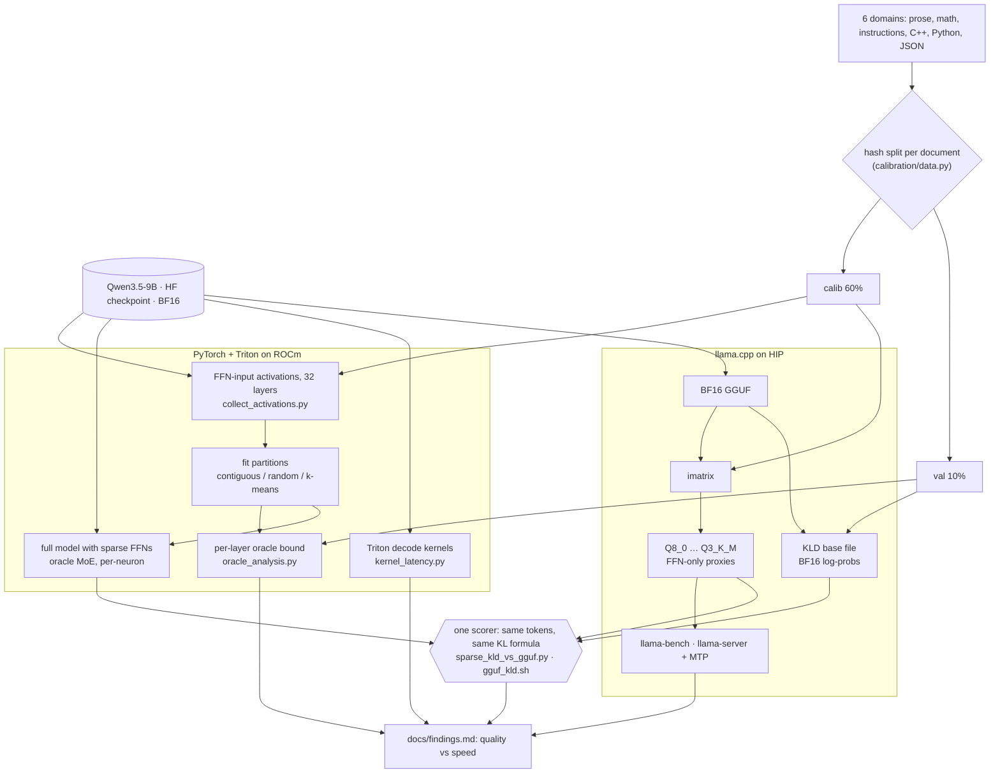
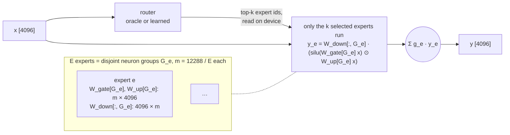

# Architecture

## Experiment pipeline

Calibration data fits everything (partitions, imatrix). Every quality number is measured on
held-out validation text, against one llama.cpp BF16 reference, so PyTorch sparse variants and
GGUF quants land in the same table.



## Conversion

One SwiGLU FFN split into E experts along the intermediate dimension. With every expert selected
and unit weights, the sum is the dense output exactly.



Each Qwen3.5 SwiGLU FFN (`gate_proj`, `up_proj`: [12288, 4096], `down_proj`: [4096, 12288],
no biases) is split along the intermediate dimension by a `Partition`: E disjoint,
equal-size neuron groups (`partitioning/strategies.py`). Expert e gets the rows `G_e` of gate/up
and the columns `G_e` of down (`models/ffn.py::PartitionedFFN.from_dense`).

```
y = sum_{e in S(x)} g_e(x) * W_down[:, G_e] (silu(W_gate[G_e] x) * (W_up[G_e] x))
```

**Invariant:** with S(x) = all experts and g_e = 1, y equals the dense FFN output exactly, up to
float summation order. This is enforced by `tests/test_reconstruction.py` (fp64 1e-12, fp32 1e-6,
bf16 no worse than dense bf16, bitwise-exact weight round trip) and
`tests/test_real_weights.py` (real layer-15 weights). `scripts/oracle_analysis.py` also asserts
it on every layer before measuring anything.

Combination modes (`routing/oracle.py::indices_to_weights`):
- `sum`: g_e = 1 for selected experts. Preserves the invariant. **Default.**
- `softmax_renorm`: softmax over router scores of the selected experts, summing to 1. This is
  llama.cpp `qwen35moe` semantics. Implemented only to measure how much it hurts.
- `scaled`: g_e = E/k (DSMoE-style).

## Partition strategies
| name | basis |
|---|---|
| contiguous | neurons [e·m, (e+1)·m) |
| random | seeded uniform permutation |
| kmeans_gate_weights | balanced k-means on normalized W_gate rows (MoEfication / LLaMA-MoE parameter clustering) |
| kmeans_coactivation | balanced k-means on binary "in token's top-10% by contribution" vectors (CMoE-style) |
| kmeans_contribution | balanced k-means on per-token normalized contribution vectors |

Balanced k-means uses a greedy capacity-constrained assignment, an approximation to CMoE's
Jonker-Volgenant assignment.

## Routing
- `routing/oracle.py`: upper bounds that see the true expert outputs (`exhaustive`: exact best
  subset via Gram matrix; `greedy`; `norm`) and controls (`static` = fixed subset, i.e. structured
  pruning; `random`).
- Learned routers: not yet implemented (gated on oracle results).

## Inference kernels (`inference/sparse_ffn.py`)
Expert storage: `w_gu [E, 2m, d]` (gate rows then up rows), `w_down [E, d, m]`. Each expert is one
contiguous slab.
- `moe_decode_triton`: two Triton kernels. A gathered gate+up GEMV with SiLU·mul fused, then a
  gathered down GEMV with split-K and atomic accumulation. They read expert ids from device memory,
  so there's no host sync and no weight copy, and they are CUDA-graph capturable.
- `route_topk_triton`: fused router GEMV + top-k in one program.
- `moe_decode_loop` (host sync) and `moe_decode_gather` (weight copy) are naive baselines.
- `moe_prefill_loop`, `moe_prefill_grouped` (`torch._grouped_mm`) handle T > 1.

## Code map
```
src/dense_to_moe/
  models/ffn.py               DenseFFN, PartitionedFFN
  partitioning/strategies.py  Partition + strategies
  routing/oracle.py           oracle/control selection, combination weights
  inference/sparse_ffn.py     dense and sparse kernels for benchmarking
  calibration/data.py         licensed sources, hash-based disjoint splits, sequence packing
  calibration/collect.py      hook-based FFN-input capture (subsampled, CPU-offloaded)
  evaluation/metrics.py       rel err, cosine, MSE, utilization
  utils/                      env capture, HF range fetch, local checkpoint loading
benchmarks/kernel_latency.py  single-layer latency (decode + prefill)
scripts/collect_activations.py, scripts/oracle_analysis.py
```
